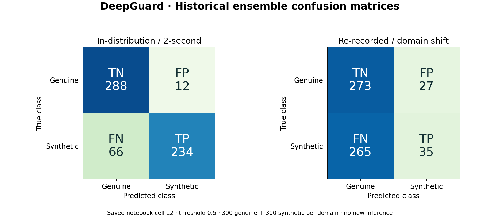
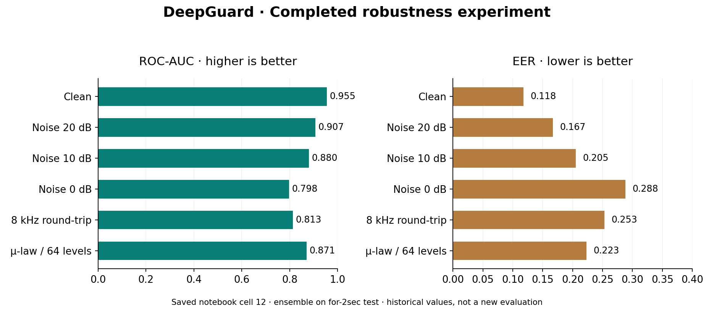

# DeepGuard: Technical Report

## Current update — supplied checkpoints, 30 October 2026

**Verification completed:** 26 automated tests passed, 1 synthetic-class test skipped. Real Edge browser testing passed for upload, analysis, individual CNN outputs, desktop/mobile layout and invalid-audio handling. See [current verification](reports/CURRENT_VERIFICATION.md). The local detector is running; two-class scientific evaluation awaits the verified synthetic sample.

All three supplied checkpoints are now installed in `models/` and load strictly into the unchanged architecture. Each is 403,281 bytes, contains 30 state entries, has finite tensors and four BatchNorm counters of 65. Hashes and tensor shapes are recorded in [checkpoint audit](reports/checkpoint_audit.json). Positive counters are evidence of training-state updates, not proof of accuracy or historical provenance. Counter 65 is consistent with the notebook's later five-epoch/800-clip run (13 batches × 5 epochs); it does not match the earlier twelve-epoch/3,000-clip run. **Historical scores must not be attributed to these files.**

The existing FastAPI ensemble now produces actual predictions, including individual CNN labels/probabilities. The UI preserves its existing design and adds those individual outputs. Run `python run.py` after installing requirements, or use `Start_DeepGuard.cmd` on this computer.

### Fresh, explicitly labelled sample

The user confirmed `audio_2026-10-30_18-28-14.ogg` is human-recorded (label 0). Only its first two seconds are classified. No synthetic sample has yet been verified. Clean inference returned **SYNTHETIC / DEEPFAKE**, synthetic probability **0.702832**, genuine probability **0.297168**. This is a **false positive**, not a successful authenticity verdict.

| Condition | Synthetic probability | Prediction | Correct for human label? |
|---|---:|---|---|
| clean | 0.702832 | SYNTHETIC / DEEPFAKE | No |
| noise_20dB | 0.243202 | GENUINE HUMAN SPEECH | Yes |
| noise_10dB | 0.160994 | GENUINE HUMAN SPEECH | Yes |
| noise_0dB | 0.048063 | GENUINE HUMAN SPEECH | Yes |
| mulaw_64 | 0.780524 | SYNTHETIC / DEEPFAKE | No |
| 8khz_roundtrip | 0.577566 | SYNTHETIC / DEEPFAKE | No |


These are fresh inference results with the supplied weights. The one-sample clean accuracy is 0/1 (0%); confusion matrix, rows=true and columns=predicted genuine/synthetic, is `[[0,1],[0,0]]`. Precision, recall, F1, ROC-AUC and EER are **not reported as two-class performance** because only genuine ground truth is available. Noise variants are correlated versions of one sample and cannot establish general robustness. No source exclusion can be verified, so unseen-source evaluation remains pending.

Reproduce without training:

```powershell
pip install -r requirements-dev.txt
python -m src.evaluate --manifest demo/evaluation_manifest.json
python -m pytest -q
```

To evaluate an additional verified sample, append its path, label (0 genuine / 1 synthetic) and `label_source` to the manifest. Never infer labels from filenames. Fresh outputs go to [reports/fresh_evaluation.json](reports/fresh_evaluation.json); historical results remain in [reports/results.json](reports/results.json). The tool computes all requested metrics when both classes are present. A two-clip check still is not a representative benchmark.

## Assignment scope and methodology

The image is mapped requirement by requirement in [TASK_COMPLIANCE.md](TASK_COMPLIANCE.md). Historical model-quality results below refer to the original notebook experiment, not the currently supplied checkpoints.

Evidence-based finalization of the supplied deepfake audio detection project. No training or model-weight generation was performed. Results below are historical notebook outputs, not new local model evaluations. Cell indices refer to the preserved notebook and are zero-based.

## 1. Abstract

DeepGuard wraps an existing three-CNN speech classifier in a local FastAPI/HTML application. The completed ensemble experiment reports ROC-AUC 0.955 and EER 0.118 on 600 in-distribution clips, falling to AUC 0.758 and EER 0.278 on 600 re-recorded clips. At the original threshold of 0.5, re-recorded synthetic recall is only 11.7%. Existing Random Forest baselines, feature comparisons, confusion matrices and degradation tests are preserved. The application provides waveform and Log-Mel inspection, and real classification runs using the supplied checkpoints; full evaluation of those weights remains pending. Artifact integrity and limitations are documented explicitly.

## 2. Introduction

Speech synthesis creates a need for tools that examine whether audio resembles genuine or generated speech. Learned acoustic evidence can be sensitive to recording hardware and post-processing. Evaluation beyond a clean matched test set is therefore essential. This project tests an existing convolutional approach and separates experimental evidence from deployment readiness.

## 3. Problem Statement

Given speech audio, produce a genuine/synthetic label and model probabilities. The assignment emphasizes unfamiliar sources or speech-generation systems. The completed research provides a re-recorded acoustic-domain test; it does not document a generator-held-out protocol. This distinction limits how strongly generalization can be claimed.

## 4. Dataset

The source uses the Fake-or-Real dataset through the `mohammedabdeldayem/the-fake-or-real-dataset` mirror. The [authors' dataset page](https://bil.eecs.yorku.ca/datasets/) identifies genuine and synthesized speech and explains the `for-original`, `for-norm`, `for-2sec`, and `for-rerec` variants. `for-rerec` re-records the two-second material to simulate a voice channel. Dataset-level source names do not establish which generators or speakers occur in this experiment's sampled files.

The local implementation does not depend on Kaggle. Dataset paths occur only in the archived source. Raw audio, per-file split manifests, speaker identities and generator labels were not supplied with the notebook.

## 5. Dataset Preparation

Cell 2 records 6,978 genuine plus 6,978 fake training files; 1,413+1,413 validation files; 544+544 test files. All 17,870 files have WAV extensions. The inspected sample is mono-compatible 16-kHz, 32,000-sample audio. Later cell 9 explicitly loads a capped subset:

| Split used for the reported ensemble | Genuine | Synthetic | Total |
|---|---:|---:|---:|
| for-2sec training | 1,500 | 1,500 | 3,000 |
| for-2sec validation | 300 | 300 | 600 |
| for-2sec testing | 300 | 300 | 600 |
| for-rerec validation | 300 | 300 | 600 |
| for-rerec testing | 300 | 300 | 600 |

Within each class directory, filenames are sorted and shuffled with a newly initialized `np.random.RandomState(0)`; the first capped number is selected. This preserves predefined directory splits, but is not a fresh stratified speaker split. There is no evidenced duplicate-hash audit, speaker-group exclusion or cross-variant original-utterance audit. Calling this fully leakage-safe would overstate the code. The original single-CNN search used re-recorded validation EER for model selection, so the re-recorded domain was not entirely unseen during development.

EDA consists of directory/class counts, file types, an inspected sample's format, and RMS/near-silence summaries (cell 10). A comprehensive demographic or per-speaker EDA is not evidenced. All claims about dataset size above come from saved output rather than a new enumeration of local audio.

## 6. Preprocessing

SoundFile reads float32 samples. Multi-channel audio is averaged along the channel dimension. Torchaudio resamples to 16,000 Hz when necessary. The pipeline takes the beginning of each clip, crops to 32,000 samples, and pads zeros on the right if shorter. It does not randomly crop or analyze later segments during inference. A long file's verdict therefore describes only its first two seconds.

The deployment uses the exact operations from the source. Metadata reports original duration, sample rate and channels separately from the fixed model input. Upload limits are deployment safeguards (20 MB, 60 seconds, up to 8 channels and 192 kHz), not changes to training preprocessing. No deployment-time noise injection, denoising, amplitude normalization or silence removal is added.

## 7. Feature Extraction

Primary representation: power Mel spectrogram with `n_fft=512`, `hop_length=160`, `n_mels=64`, 16-kHz rate, followed by `AmplitudeToDB()`. This corresponds to a 32-ms FFT window and 10-ms hop. Torchaudio defaults include Hann window, centered reflect padding, HTK Mel scale, power 2 and no Mel-area normalization. Centered extraction yields 201 frames for the fixed input. The tensor is `[batch, 1, 64, 201]`.

Each sample is standardized across its channel, frequency and time dimensions: `(f - mean(f)) / (std(f) + 1e-5)`. PyTorch's default sample-standard-deviation correction is preserved. The app plots pre-standardization dB values while passing standardized values to the CNN. The [Torchaudio transform reference](https://docs.pytorch.org/audio/2.8.0/generated/torchaudio.transforms.MelSpectrogram.html) documents these defaults; the original environment versions were not recorded.

Additional representation: 40 MFCCs extracted with the same FFT, hop and 64 Mel bands. Temporal mean and sample standard deviation yield 80 RF features. The Log-Mel RF comparison uses 128 features (64 means + 64 standard deviations). MFCCs summarize spectral-envelope structure; pooled statistics discard temporal ordering. This comparison evaluates representation choice within the RF family as well as contrasting a classical classifier with the CNN. It is not a controlled isolation of every architecture/feature factor.

## 8. Baseline Model

Cell 10 fits `RandomForestClassifier(300, n_jobs=-1, random_state=0)` to training features. For each domain, its threshold is derived from that domain's validation EER operating point, not the test labels. Reported baseline output:

| Model / representation | Domain | Accuracy | Precision | Recall | F1 | AUC | EER |
|---|---|---:|---:|---:|---:|---:|---:|
| RF / Log-Mel statistics | 2sec | 0.682 | 0.950 | 0.383 | 0.546 | 0.923 | 0.160 |
| RF / Log-Mel statistics | rerec | 0.583 | 0.588 | 0.557 | 0.572 | 0.607 | 0.418 |
| RF / MFCC statistics | 2sec | 0.598 | 0.650 | 0.427 | 0.515 | 0.593 | 0.433 |
| RF / MFCC statistics | rerec | 0.430 | 0.306 | 0.110 | 0.162 | 0.337 | 0.602 |

In this completed run, Log-Mel statistics outperform MFCC statistics by AUC in both domains. This does not establish that MFCCs are generally unsuitable. RF thresholds differ from the ensemble's fixed 0.5; threshold-specific accuracy is not a fully controlled comparison. RF code/results are preserved, but no fitted RF model artifact is available.

## 9. CNN Architecture

| Stage | Operation | Output per clip |
|---|---|---|
| Input | Standardized Log-Mel | 1 × 64 × 201 |
| Block 1 | Conv 1→16, BN, ReLU, max pool 2 | 16 × 32 × 100 |
| Block 2 | Conv 16→32, BN, ReLU, max pool 2 | 32 × 16 × 50 |
| Block 3 | Conv 32→64, BN, ReLU, max pool 2 | 64 × 8 × 25 |
| Block 4 | Conv 64→128, BN, ReLU, max pool 2 | 128 × 4 × 12 |
| Pool | Adaptive average pool to 1×1 | 128 × 1 × 1 |
| Head | Flatten, dropout 0.3, Linear 128→2 | 2 logits |

All convolutions use 3×3 kernels, padding 1, and the original defaults. Local spectral-temporal patterns motivate convolutions; pooling reduces resolution; global pooling creates a fixed-size summary. These are design rationales, not interpretability findings about individual learned filters. The source does not include saliency or causal feature ablations.

Historical cell 11 trains seeds 0/1/2 for twelve epochs using AdamW (learning rate 3e-4, weight decay 1e-4), cosine scheduling, batch size 64 and cross-entropy. Training augmentation applies gain in [0.3,1.5) and, with probability 0.5, Gaussian noise with SNR in [5,30) dB. The final epoch is saved per seed. This paragraph documents existing code; no training was executed now.

## 10. Ensemble

Each network is placed in evaluation mode; class-1 softmax probability denotes synthetic speech. The arithmetic mean of three probabilities is compared to **0.5**, with equality classified synthetic. This combines different seed trajectories without changing the architecture. It may reduce variance; three seeds do not provide a confidence interval or prove robustness.

Cell 11 seed AUC/EER values on the 2sec test are 0.927/0.147, 0.930/0.152, and 0.948/0.137; re-recorded values are 0.678/0.363, 0.752/0.295, and 0.776/0.258. Cell 12 provides the ensemble results. Later Gradio code incorrectly reuses the earlier single-CNN threshold 0.871. Deployment explicitly follows cell 12's evaluated 0.5 operating point.

## 11. Evaluation Methodology

The two ensemble test sets each contain 300 genuine and 300 synthetic samples. The reported operating-point metrics use a fixed 0.5. Cell 12 also prints a threshold selected at **test EER**, labelled “optimistic”; those accuracy/F1 values are excluded from headline results and never used as deployment thresholds. Selecting a deployment threshold using test labels would leak evaluation information.

Historical outputs are retained verbatim and metrics/matrices extracted programmatically without rerunning training or inference. The notebook does not preserve per-example probabilities, file-level predictions, uncertainty estimates or an original package lock. EER and AUC cannot be recomputed from a confusion matrix alone; the saved values remain historical evidence.

## 12. Precision / Recall / F1

Synthetic is the positive class. Precision = TP/(TP+FP); recall = TP/(TP+FN); F1 is their harmonic mean. The unmodified completed metrics are:

| Metric | In-distribution | Re-recorded |
|---|---:|---:|
| Accuracy | 87.0% | 51.3% |
| Precision | 95.1% | 56.5% |
| Recall | 78.0% | 11.7% |
| F1 | 0.857 | 0.193 |
| ROC-AUC | 0.955 | 0.758 |
| EER | 0.118 | 0.278 |

Values are rounded exactly as recorded. Rounding explains small differences when recomputing from integer matrix counts.

## 13. ROC-AUC

ROC plots true-positive versus false-positive rate across thresholds. AUC summarizes ranking quality rather than performance at one decision threshold. AUC 0.758 on re-recorded audio can coexist with poor recall at 0.5: the scores may retain useful ordering while their operating-point distribution shifts. No full ROC curve is reconstructed because the per-clip scores were not supplied.

## 14. EER

EER describes the operating region where false-positive and false-negative rates are equal. The original implementation computes `roc_curve`, chooses the discrete point minimizing `abs((1-tpr)-fpr)`, and returns `(fpr + 1-tpr)/2` at that point. This is a discrete approximation, not interpolated equality. Lower is better; 0.118 rises to 0.278 under re-recording. EER is a diagnostic summary, not the model's deployed threshold.

## 15. Confusion Matrix

These exact counts are saved in cell 12 at threshold 0.5, not inferred from rounded percentages. Rows are true labels; columns are predictions; order is genuine, synthetic.

| In-distribution, n=600 | Predicted genuine | Predicted synthetic |
|---|---:|---:|
| True genuine | TN 288 | FP 12 |
| True synthetic | FN 66 | TP 234 |

| Re-recorded, n=600 | Predicted genuine | Predicted synthetic |
|---|---:|---:|
| True genuine | TN 273 | FP 27 |
| True synthetic | FN 265 | TP 35 |



CSV files, JSON and figures are new presentations of these existing counts. The source counts and model metrics were not newly generated.

## 16. False Positive Analysis

A false positive is genuine speech labelled synthetic. There are 12/300 (4.0%) in-domain and 27/300 (9.0%) re-recorded false positives. These are class-conditional error rates calculated from the actual matrices. Such errors can wrongly cast doubt on genuine recordings. The supplied files lack per-example predictions/audio, so phonetic, speaker or acoustic causes cannot be assigned to particular errors.

## 17. False Negative Analysis

A false negative is synthetic speech labelled genuine. There are 66/300 (22.0%) in-domain and 265/300 (88.3%, rounded) re-recorded false negatives. Most re-recorded synthetic samples are missed at the fixed operating point. This is the clearest deployment limitation; a “genuine” result is not proof of human origin. Individual error inspection was not possible from the supplied artifacts.

## 18. Generalization / Domain Shift Evaluation

The re-recorded test preserves a substantial performance drop and is not omitted from the application or report. Re-recording can alter frequency response, reverberation and noise, plausibly changing cues used by the model; the experiment does not isolate those causal factors. This is a changed-channel test within a dataset family, not demonstrated universal generalization to new generators. Because related validation was examined during development, describe it as a held-out test split under domain shift rather than an entirely untouched new domain. A generator/source-disjoint protocol remains unverified.

## 19. Noise Robustness

Cell 12 adds Gaussian noise scaled from per-clip signal power to requested SNR. Lower SNR means more noise. These are existing ensemble results:

| Condition | ROC-AUC | EER |
|---|---:|---:|
| Clean | 0.955 | 0.118 |
| 20 dB noise | 0.907 | 0.167 |
| 10 dB noise | 0.880 | 0.205 |
| 0 dB noise | 0.798 | 0.288 |

Performance worsens as noise increases in this recorded run. The source does not report repeated noise draws or error bars; exact numerical repeatability is not established. Gaussian noise is not a substitute for testing traffic, competing speakers or reverberant rooms.

## 20. Compression Robustness

| Condition | ROC-AUC | EER |
|---|---:|---:|
| Clean | 0.955 | 0.118 |
| μ-law, 64 levels | 0.871 | 0.223 |
| 16→8→16 kHz resampling | 0.813 | 0.253 |

The μ-law function clamps amplitudes to [-1,1], then encodes and decodes with 64 quantization levels. The narrowband condition resamples to 8 kHz and back to 16 kHz; 8 kHz denotes sample rate, not an 8-kHz audio passband. Neither test measures MP3, AAC or Opus behavior. These curves are degradation summaries, not performance for arbitrary codecs.



## 21. Dataset / Speaker Limitations

Cell 10 evaluates RMS and near-silence fraction (`abs(x) < 1e-4`):

| Split | Mean RMS real / fake | Silence fraction real / fake | AUC of RMS alone |
|---|---|---|---:|
| Train | 0.1533 / 0.1785 | 0.0067 / 0.0292 | 0.688 |
| 2sec test | 0.1688 / 0.2110 | 0.0103 / 0.0221 | 0.787 |
| Re-recorded test | 0.3390 / 0.4095 | 0.0178 / 0.0147 | 0.740 |

These associations demonstrate available dataset cues, not causal proof that the CNN depends on them. Per-clip spectrogram normalization does not establish complete shortcut removal. A controlled RMS/silence equalization ablation and speaker-group experiment were **not performed in the existing experiment**. Speaker-specific shortcut analysis is a limitation/future experiment. No verified speaker-disjoint claim, demographic fairness claim or comprehensive new-generator claim is made.

## 22. Local Deployment

`python run.py` serves FastAPI and HTML/CSS/JavaScript at localhost:8000. Feature preview reads the upload once, computes the original waveform envelope and model-window Log-Mel, and returns metadata. The classification route additionally runs all three models and averages softmax probabilities. The browser displays both class scores, confidence, label and audio details.

Startup loads all three strict state dictionaries through `torch.load(weights_only=True)` into meta-constructed copies of the original architecture. This allocates no replacement parameter values. All tensors must be finite; BatchNorm training counters must be positive to reject the known random-export case. Partial model loading never enables predictions. Missing or incompatible checkpoints produce a degraded health response and HTTP 503 on prediction. This check detects obvious untrained exports but does not prove provenance.

The deployment is separated from the preserved research archive. It executes no Colab paths, Kaggle downloads, Gradio launches or training. File limits and decoder validation are exercised by software tests. See [verification evidence](reports/VERIFICATION.md) for actual execution status.

## 23. Limitations

The initial filesystem search did not find checkpoints or dataset test audio. The user subsequently supplied three checkpoints and one confirmed human recording; the current audit is documented above. Access errors and search limitations are recorded in `reports/FILE_SEARCH.json`. The notebook includes a random-weight overwrite in cell 19 and a later five-epoch retraining in cell 32, both using the same filenames as the evaluated twelve-epoch ensemble. Saved success messages and file sizes cannot establish checkpoint identity. No fitted baseline artifact was supplied either.

The original library versions, split manifests and prediction arrays are unavailable. Re-recording is not generator-held-out testing; split leakage has not been audited; speaker ablation and causal shortcut tests are missing. Results are balanced-subset estimates, not calibrated deployment error rates across languages, speakers or recording channels. The first-two-second policy can miss later speech or manipulated segments. No new inference claim is made without original models.

## 24. Future Work

Recover provenance-linked original weights and original test clips; compute hashes and run inference-only regression. Audit duplicate/source/speaker overlap before asserting leakage prevention. Then, in a separately authorized experiment, test withheld generators, controlled channel/speaker conditions, calibration using validation data, and broader codecs/noise. Consider multi-window inference only as a separately evaluated pipeline change. None of these future experiments was performed during finalization.

## 25. Conclusion

The completed experiment supports strong ranking on its in-distribution subset and substantial degradation under re-recording, noise and quantization. DeepGuard preserves that evidence and the original model pipeline in a local application with transparent readiness and feature visualization. The supplied checkpoints now provide working inference; the confirmed human recording was falsely classified synthetic, so model quality is not established by the functioning demonstration. The missing scientific controls remain explicit in the compliance table.
